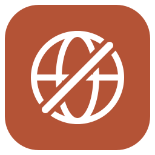

# Mac HTTPDNS 拦截器

阻止清单内 HTTPDNS 域名、常见 HTTP(S) 端口上的硬编码解析 IP，并补充明文 HTTP 路径拦截。

目标版本：Loon for Mac 0.5.0（1009）。包含 81 条网络规则、42 条明文 HTTP 复写，无脚本、无 MitM、无需绑定代理策略。

[插件源码](Loon-Mac-HTTPDNS-Block.plugin) · [下载插件](https://raw.githubusercontent.com/hclchcl/loon-mac-httpdns-block/main/Loon-Mac-HTTPDNS-Block.plugin) · [来源与许可](NOTICE.md)

## 导入 Loon

在 **Mac Loon → 插件 → 添加插件** 中粘贴：

```text
https://raw.githubusercontent.com/hclchcl/loon-mac-httpdns-block/main/Loon-Mac-HTTPDNS-Block.plugin
```

无需安装证书、启用 MitM 或配置 PROXY。 替换使用时先关闭对应的原插件，保留原文件便于回滚。

本仓库是独立功能适配项目，覆盖与可莉原插件不同；按用户要求，未进行实机导入或效果测试。

## 覆盖方向

来源清单包含阿里、百度、哔哩哔哩、华为、爱奇艺、京东、酷我、美团、网易、腾讯云、字节跳动、微博、微信、企业微信等 HTTPDNS 端点。每条具体规则以插件明文为准，不表示已经在各家 Mac 客户端实际触发。

- 对清单内的专用 HTTPDNS 域名使用原生域名拒绝规则。
- 对清单内硬编码 IPv4/IPv6 地址，将阻断范围限定为目标端口 80、443、8080，避免把同一地址的所有端口都直接封禁。
- 另选取来源中的 HTTPDNS 请求路径，转为 Loon 原生 Rewrite；仅匹配明文 HTTP，并返回 503，使请求立即失败。

## 相对来源的修改

以 VirgilClyne/GetSomeFries 的 `HTTPDNS.Block.sgmodule` 为依据；保留完整上游快照及 GPL-3.0 许可。

移除了 Surge 专属的 `force-http-engine-hosts`、`pre-matching`、`extended-matching` 和 `%APPEND%`；没有把不属于 Loon 插件支持范围的参数直接搬入。去除重复项，增加路径边界，排除了上游含非法 IPv4 地址 `182.256.116.116` 的复写及未按 URL 方括号格式书写的 IPv6 路径规则，没有擅自猜测正确地址。原来的独立 IPv6 网络规则仍保留。

HTTPS 路径复写和 Map Local 没有纳入；专用域名和清单内 IP 的网络规则仍可拦截对应 HTTP(S) 连接。其他共享域名上的加密 HTTPDNS 不保证覆盖。逐条选择记录见 [httpdns-changes.json](sources/httpdns-changes.json)。

## 安装与回滚

导入后建议关闭原 HTTPDNS 拦截器，再启用本插件。不需要修改现有加密 DNS 配置。应继续保留你已经配置好的 DNS 防泄漏措施。

部分应用可能不接受 HTTPDNS 失败，出现登录、聊天、图片、播放或联网问题。此时先停用本插件恢复，再由你检查具体命中的请求；不能把应用报错说成正常回落。需要恢复原行为时，停用本插件并重新启用原插件即可。

未进行实机导入、联网、回落或泄漏测试。


## 来源与许可

本插件按 [GPL-3.0](LICENSE) 单独发行，保留上游署名、来源和适配记录，详见 [NOTICE](NOTICE.md) 与 [来源清单](sources/manifest.json)。

## 相关插件

- [Mac 广告平台拦截器](https://github.com/hclchcl/loon-mac-ad-platforms-block)
- [Mac 应用与网页广告过滤器](https://github.com/hclchcl/loon-mac-ad-filter)
- [Mac DNS 防泄漏](https://github.com/hclchcl/loon-mac-dns-guard)

## 名称与图标

插件文件已内置 `#!name` 和 `#!icon`。请使用插件原始直链导入；名称与图标由 Loon 读取文件头信息。已导入的插件可先更新；本地自定义名称或图标可能继续保留，需要时在导入界面使用默认信息。

图标为本项目原创，提供 [PNG](icon.png) 和可编辑 [SVG](icon.svg)。本次只更新展示信息与图标资源，未进行 Loon 导入或联网测试。
